  

### 🎧 Track 01 · Intro

Product engineer and tech lead in Dubai, with 10+ years of building backend systems across FinTech, SaaS and AdTech. I start from the business problem, own it from design to production, and these days pair with AI coding tools to ship a product's full lifecycle.

### 💿 Discography

| Years | Release | What it was about |
|---|---|---|
| **2025 → now** | **Rapyd** · Senior Domain Owner (Lead Forward Deployed Engineer) | KYB onboarding, merchant screening and transaction monitoring for the risk and compliance teams |
| **2022 → 2025** | **SAVii** · Tech Lead, SDE 3 | Led a team of 6, broke a Java monolith into FastAPI microservices, built a Kong gateway with custom Lua plugins |
| **2016 → 2022** | **Vidtech.AI / Tyroo** · Lead Engineer | Built a SaaS ad platform from scratch, from EC2 to Lambda to Kubernetes on EKS |

### 🎛️ Instruments

**Session players:**  

### 🔊 B-side · what I build for fun

When I'm not building compliance systems, I'm building tools for my own music library.

**[music-suite](https://github.com/ra9-dev/music-suite)**: a Spotify playlist manager that hunts down duplicate tracks in three passes, by exact track, by recording (ISRC), and by fuzzy title and artist, so "Song (Remastered 2011)" and "Song" finally meet. FastAPI + React/TypeScript. Next up: moving playlists across Spotify, Apple Music and YouTube Music.

### 🎼 Liner notes

- **Impact over output.** A feature nobody uses is just noise.
- **The why before the how.** Code without context is guesswork.
- **Own the product, not the ticket.** Ship it, watch it, fix it.

### 📻 Tune in

Most of my work lives in private company repos. What you see here is the B-side.
