  

  

  

<i>10+ years of backend systems across FinTech, SaaS and AdTech. I start from the business problem and own it all the way to production.</i>

### 🗺️ Quest log

| Years | Guild · Role | Quest |
|---|---|---|
| **2025 → now** | **Rapyd** · Senior Domain Owner (Lead Forward Deployed Engineer) | KYB onboarding, merchant screening and transaction monitoring for the risk and compliance teams |
| **2022 → 2025** | **SAVii** · Tech Lead, SDE 3 | Led a team of 6, broke a Java monolith into FastAPI microservices, built a Kong gateway with custom Lua plugins |
| **2016 → 2022** | **Vidtech.AI / Tyroo** · Lead Engineer | Built a SaaS ad platform from scratch, from EC2 to Lambda to Kubernetes on EKS |

### 🎒 Inventory

  

**Party members:**  

### 🕹️ Side quest

When I'm not fighting compliance bosses, I'm building tools for my own music library.

**[music-suite](https://github.com/ra9-dev/music-suite)**: a Spotify playlist manager that hunts down duplicate tracks in three passes, by exact track, by recording (ISRC), and by fuzzy title and artist, so "Song (Remastered 2011)" and "Song" finally meet. FastAPI + React/TypeScript. Next up: moving playlists across Spotify, Apple Music and YouTube Music.

### 📜 House rules

- **Impact over output.** A feature nobody uses is just noise.
- **The why before the how.** Code without context is guesswork.
- **Own the product, not the ticket.** Ship it, watch it, fix it.

### 👾 Player 2, join in

Most of my work lives in private company repos. What you see here is the side quests.

